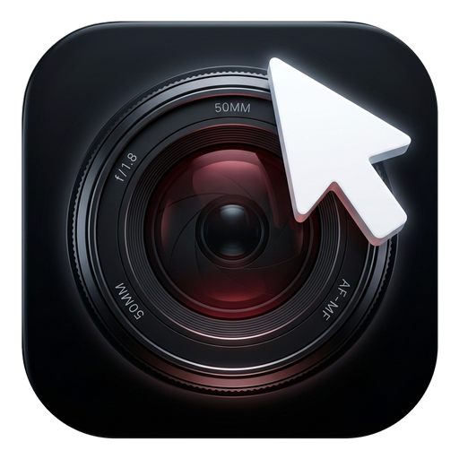
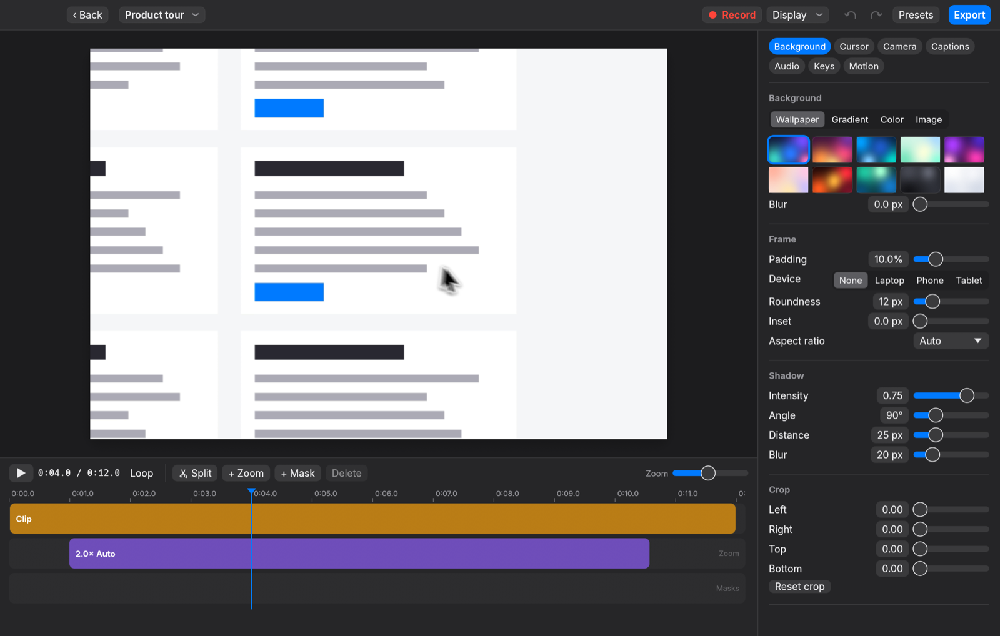
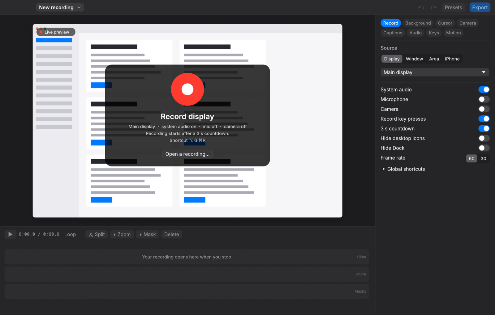
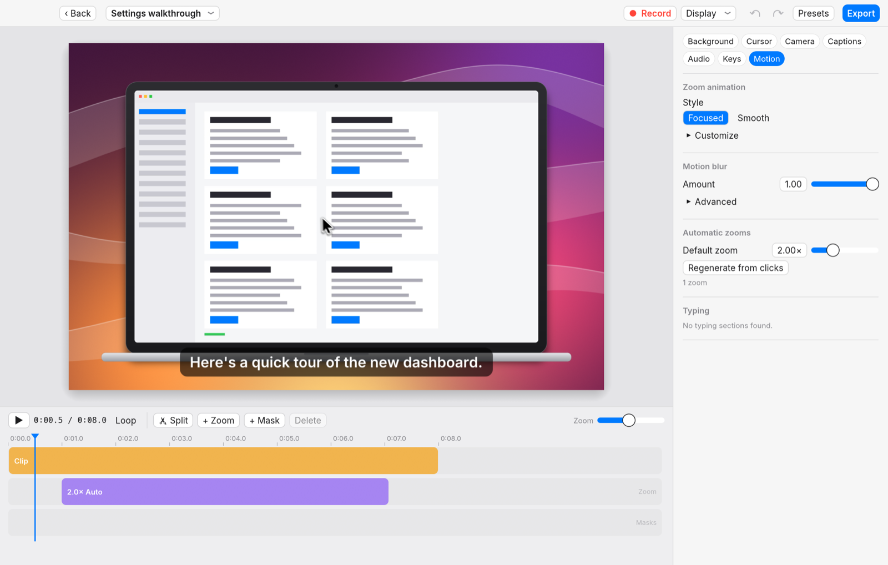

# Glide

A fast, fully open-source, native Rust screen recorder for polished product
videos on macOS. Record your screen, a window, an area or an iPhone; Glide
re-renders the cursor, zooms into what you click with spring animations, adds
a background, shadow and rounded corners, and exports MP4 or GIF with the
hardware encoder — usually several times faster than real time.

Behaviour was reverse engineered from Screen Studio using REA and Claude
Code (see `analysis/SCREEN_STUDIO.md`). Glide is not affiliated with or
endorsed by Screen Studio or its authors and contains none of its code or
assets: wallpapers, cursors, device frames, click sounds and the app icon are
generated by Glide's own code.



## Features

- **Recording**: display, window (picked on screen; follows the window), drag-selected area,
  USB iPhone/iPad; system audio and microphone on separate tracks; camera;
  countdown, pause/resume, restart, cancel; hide desktop icons and the Dock;
  resize the window you record to a preset or custom size;
  configurable global shortcuts (default ⌥⇧⌘R); menu bar recorder.
- **Automatic zoom** from clicks with cluster targeting and edge snapping,
  spring physics and motion blur; manual and follow-mouse zooms.
- **Cursor** re-rendered at high resolution with smoothing, tilt, press
  feedback, idle hiding, click circles/ripples and optional click sounds.
- **Styling**: generated wallpapers, gradients, colours, your own image or
  current desktop picture; padding, roundness, shadow, inset, crop, aspect
  ratios; laptop/phone/tablet device frames; style presets.
- **One window**: Glide opens on recording setup in the editor's own layout
  (a live preview of the selected display, window or area under a big Record
  button; source and audio options in the inspector); a
  recording opens straight into the editor when you stop; recent recordings
  are a popover off the window title.
- **Editor**: live GPU preview, timeline with clips, zooms, masks and camera
  layouts; split, trim, speed, typing speed-up; blur/pixelate/highlight
  masks with "data may be visible" warnings when the covered content moves
  (one click cuts that part); camera bubble and layouts; keyboard-shortcut overlay; on-device
  captions with Whisper (base/small/medium) or Apple Speech, editable;
  voice-over with ducking; on-device ML voice isolation
  ("Enhance voice"); background music; style presets; undo/redo.
- **Export**: MP4 (H.264/HEVC via VideoToolbox, zero-copy GPU → encoder),
  GIF with delta frames; 720p to 4K, 10–60 fps; quality presets with size
  estimates or "fit to file size"; "Export & copy" to the clipboard.




Screenshots use Glide's synthetic demo recordings (`glide synth`).

See `PERFORMANCE.md` for measured recording overhead and export speed, and
`PROGRESS.md` for the full parity table and verification notes.

## Build

Requires macOS 15+, Rust (2024 edition), Xcode and CMake (`brew install
cmake`, used to build whisper.cpp for captions). The scripts set `SDKROOT`
to Xcode's SDK; for a plain `cargo build`, do the same if CMake's compiler
check fails with "tapi error: malformed file":
`export SDKROOT="$(xcode-select -p)/Platforms/MacOSX.platform/Developer/SDKs/MacOSX.sdk"`.

```sh
scripts/build.sh          # release build → dist/Glide.app (signed), dist/glide
open dist/Glide.app
```

Build output goes to `~/.cache/cargo-target/screenstudio-rs` (override with
`CARGO_TARGET_DIR`), never into the repository.

## Command line

```sh
dist/glide                          # open the app
dist/glide record -t 10             # record the main display for 10 s
dist/glide record --area 200,150,1280,720 --mic
dist/glide export "~/Movies/Glide/Recording.glide" --height 1080
dist/glide export Project.glide --format gif
dist/glide devices                  # displays, windows, cameras, mics, iPhones
dist/glide check-masks Project.glide # where content under masks moves
dist/glide transcribe Project.glide --engine whisper-small  # captions
dist/glide resize-window 1234 1920x1080 # window id from `glide devices`
dist/glide permissions --request
dist/glide synth demo.glide         # synthetic project (no permissions needed)
scripts/selftest.sh --screen        # end-to-end checks
scripts/bench.sh                    # performance measurements
```

## Layout

- `src/engine` — pure, tested model of every frame: springs, deterministic
  animator, time mapping, sizes, zoom, cursor, camera, captions, masks,
  device frames, typing detection.
- `src/render` — wgpu (Metal) compositor: one uber-shader with modes for
  backgrounds, shadows, the rounded window, blur, masks and device frames.
- `src/capture`, `src/recorder` — ScreenCaptureKit/AVFoundation capture and
  input logging into a `.glide` package.
- `src/media`, `src/export` — AVAssetReader decode, AVAssetWriter/VideoToolbox
  encode, audio mix, GIF.
- `src/app` — the egui app (Inter font): one editor-first window (recording
  setup when nothing is open, recent recordings off the title), recording widget,
  area picker, menu bar.

## Credits

- Capture pipeline, app chrome, menu bar and hotkey code build on
  [rec-rs](https://github.com/michaelshimeles/rec-rs) by Michael Shimeles
  (MIT OR Apache-2.0).
- Captions use [whisper.cpp](https://github.com/ggml-org/whisper.cpp) (MIT)
  through whisper-rs; Whisper models (MIT) are downloaded on first use.
- Behaviour analysis made with REA.
- Inter typeface by Rasmus Andersson (SIL Open Font License, `assets/fonts/OFL.txt`).

License: MIT OR Apache-2.0.
